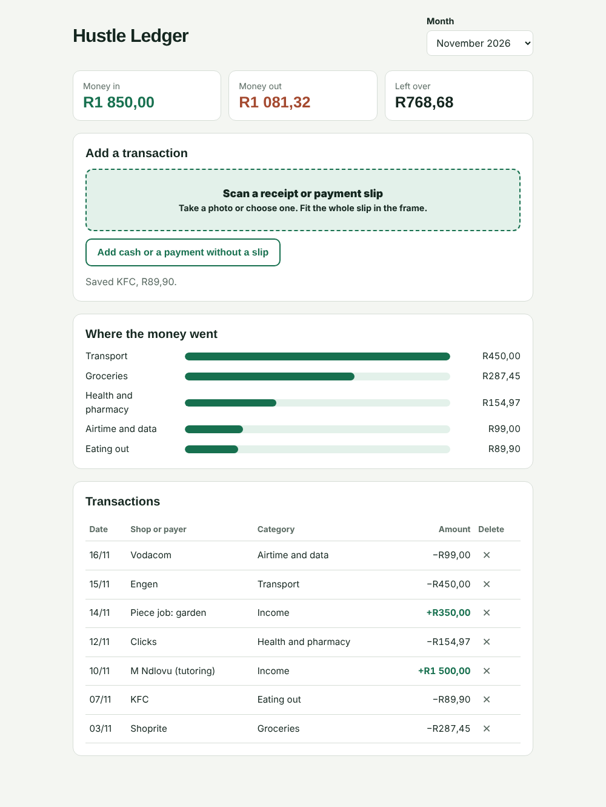
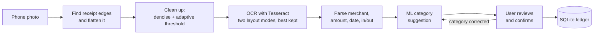
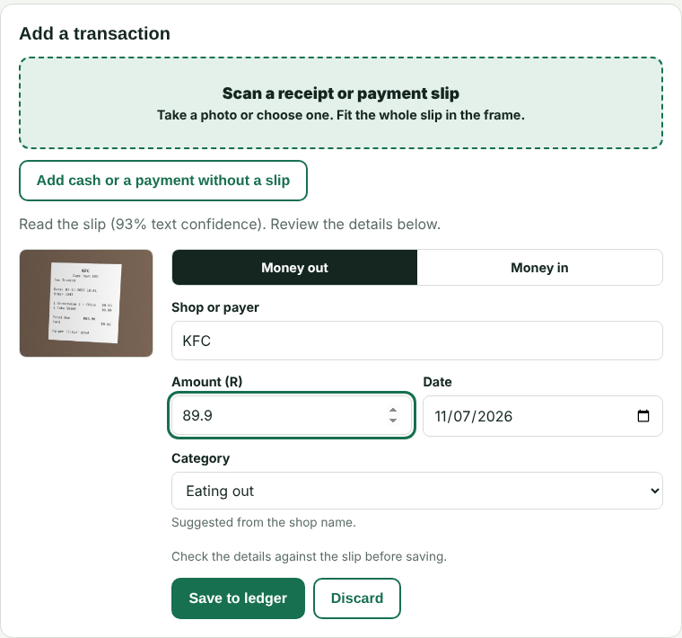
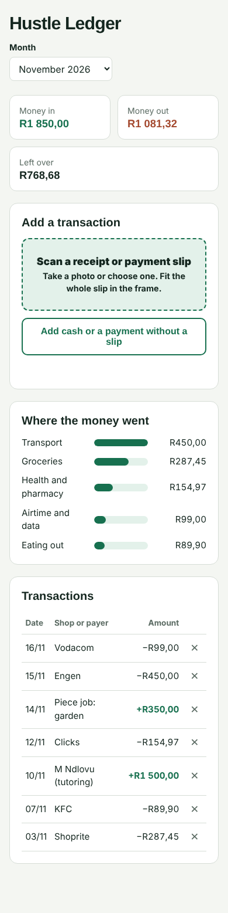

# Hustle Ledger

**Turn receipt and payment-slip photos into a monthly record of money in and money out.**

Many young South Africans earn through piece jobs, tutoring, informal trading and gig work. Their income is real but rarely on paper, which makes budgeting hard and makes it harder still to show a landlord or lender what they earn. Hustle Ledger is the first step toward fixing that: snap a photo of a till slip or a "payment received" notification and it reads the shop, amount and date, files it under a spending category, and keeps a running monthly picture of income, spending and what's left over.



## How it works



1. **Computer vision clean-up (OpenCV).** Edge detection finds the largest four-sided shape in the photo (the receipt), and a perspective transform flattens it like a document scanner. The image is upscaled, denoised and binarised with an *adaptive* threshold so shadows and uneven light don't erase text.
2. **OCR (Tesseract).** Receipts mix left-aligned item names with right-aligned prices, and Tesseract's layout modes handle that differently: single-column mode sometimes drops the prices, block mode sometimes merges columns. The app runs both and keeps the reading that recovers more words and money values, weighted by confidence.
3. **Parsing South African slips.** Amounts in local formats (`R1 299,99`, `1,299.99`), day-first dates (`03/11/2026`, `10 Nov 2026`), the *total* rather than the subtotal, VAT, cash tendered or change, fuzzy matching of local merchants so OCR slips like `SH0PRITE` still resolve, and repairs for common OCR digit mistakes (`Ril 500.00` → `R1 500.00`). Payment notifications are recognised as **money in**.
4. **Category suggestion (machine learning).** TF-IDF over word and character n-grams feeds a logistic regression classifier. Character n-grams make it tolerant of OCR typos.
5. **The user stays in control.** Nothing is saved from a scan until the user has checked it. Missing fields are flagged, and **when the user corrects a category, the model retrains with that correction**, so it learns where that person actually shops.
6. **Cash counts too.** Income from piece jobs often comes without a slip, so transactions can also be added by hand.

| Review a scan | On a phone |
|---|---|
|  |  |

## Results

On six generated test photos (receipts from Shoprite, KFC, Clicks, Engen and Vodacom, plus a Capitec "payment received" notification, each tilted, perspective-warped, unevenly lit and noisy), the pipeline extracts **every merchant, amount, date and money-in/out direction correctly** (24 of 24 fields). Two fixes came straight out of testing: running both OCR layout modes (KFC's right-aligned total was being dropped) and repairing OCR digit slips (`R1` read as `Ril`).

The category classifier is honest about its limits. It recognises the merchants in its seed set well, but with only 84 hand-labelled examples it can't know every shop: held-out accuracy on unseen merchant names is around 52%, and "Uber Eats" starts out filed as *Transport*. One correction fixes that permanently, which is why learning from corrections is built in rather than an afterthought.

> **Real-world test (in progress):** the next step is measuring accuracy on 25+ real receipts photographed in Cape Town shops, with results reported here.

## Tech stack

| Area | Tools |
|---|---|
| Computer vision | OpenCV (edge detection, perspective transform, adaptive thresholding, denoising) |
| OCR | Tesseract 5 via pytesseract |
| Machine learning | scikit-learn (TF-IDF, logistic regression) |
| Backend | FastAPI, SQLite, Pydantic validation |
| Frontend | HTML, CSS, vanilla JavaScript, mobile camera capture |
| Testing | pytest (27 tests: parsing, end-to-end photos, classifier learning, API) |

## Run it

**1. Install Tesseract OCR**
- Windows: install from [UB Mannheim's Tesseract build](https://github.com/UB-Mannheim/tesseract/wiki), keeping the default folder `C:\Program Files\Tesseract-OCR` (the app finds it there automatically; for another folder, set `TESSERACT_CMD` to the full path of `tesseract.exe`)
- macOS: `brew install tesseract` · Ubuntu: `sudo apt install tesseract-ocr`

**2. Install and start**
```bash
git clone https://github.com/Bahle05/hustle-ledger.git
cd hustle-ledger
pip install -r requirements.txt
python -m uvicorn ledger.api:app --reload
```
Open http://localhost:8000 and scan one of the photos in `samples/`, or your own receipt.

**3. Tests**
```bash
python scripts/make_sample_receipts.py   # regenerate the test photos
pytest
```

## Project structure

```
ledger/
  preprocess.py   find, flatten and clean the receipt image (OpenCV)
  ocr.py          Tesseract in two layout modes, best reading kept
  parser.py       merchant, amount, date and money-in/out from OCR text
  categorise.py   TF-IDF + logistic regression, retrained on user corrections
  store.py        SQLite ledger and monthly summaries
  api.py          FastAPI endpoints and static app
static/index.html scan, review and dashboard (mobile first)
data/             hand-labelled seed categories for South African merchants
scripts/          generator for realistic test photos
tests/            27 pytest tests
```

## Privacy

Receipts reveal where someone shops and how much they earn. Everything runs locally: photos are processed in memory and never stored, and only the confirmed transaction details go into the local database. Personal receipt photos (`my_receipts/`) and databases are excluded from git.

## Roadmap

- Accuracy report on real Cape Town receipts
- Line-item extraction (what was bought, not just the total)
- Export a verified monthly income statement as a PDF, the first step toward giving informal earners proof of income
- Larger labelled dataset and a comparison against a small fine-tuned language model for categories

## Author

**Bahle Ludidi**, BSc Computer Science (Information Systems), University of the Western Cape
[Portfolio](https://bahle05.github.io) · [LinkedIn](https://www.linkedin.com/in/bahle-ludidi-727657352) · [GitHub](https://github.com/Bahle05)
